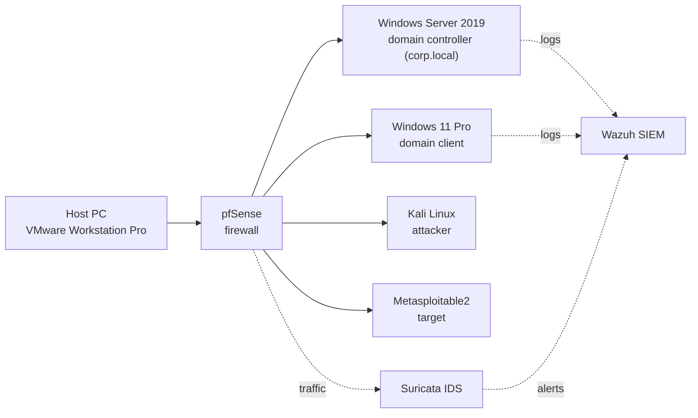

 

## `> at a glance`

| | |
|---|---|
| **Based in** | Chennai, India |
| **Experience** | IT Support Engineer (L2), Apr 2024 to Jul 2026 (2 years 2 months) |
| **Studying** | MCA with Cyber Security specialization, VIT Online (1st semester) |
| **Background** | B.E. Computer Science and Engineering, Anna University (First Class) |
| **Focus** | IT support, networking, Windows Server and Active Directory, security monitoring |
| **Home lab** | VMware lab with a Windows Server domain, pfSense, Kali Linux, Wazuh and Suricata |

## `> about`

I started in IT support and kept going deeper into the systems underneath it. For two years I handled Level 2 support for hardware, software and network issues, coordinated escalations with internal teams and vendors, and ran hands-on technical training.

To go beyond what a job covers, I built a home lab and a set of documented projects: an Active Directory attack and defense lab, a red-team C2 simulation, a network IDS written in Python, a 13-project IT support portfolio, and a self-hosted SOC with Wazuh and Suricata. I am now studying an MCA with a Cyber Security specialization at VIT Online, and I keep practising on Hack The Box and other platforms.

## `> tech stack`

  

| Area | What I work with |
|---|---|
| **IT support** | Level 1/2 troubleshooting, help desk, incident and escalation handling, user account management, remote desktop support |
| **Systems** | Windows, Windows Server 2019, Active Directory, Group Policy, Linux, VMware Workstation, PowerShell |
| **Networking** | TCP/IP, DNS, DHCP, VLAN, LAN, NAT, routing and switching basics, pfSense, packet analysis |
| **Security** | SIEM and IDS monitoring, incident response, vulnerability scanning, ethical hacking fundamentals, MITRE ATT&CK |
| **Scripting** | Python (Scapy, Flask), PowerShell, Bash |

## `> education and learning`

| | Program | Status |
|---|---|---|
| 🎓 | **MCA, Cyber Security specialization**, VIT Online |  |
| 🎓 | **B.E. Computer Science and Engineering**, T.S.M. Jain College of Technology (Anna University), 2020 to 2023 |  |
| 🎓 | **Diploma in Computer Engineering**, Adhiparasakthi Polytechnic College, 2016 to 2019 |  |

## `> experience`

**IT Support Engineer (L2)**, Chennai Apple System Solutions, Chennai · Apr 2024 to Jul 2026

- Provided Level 2 support for hardware, software and network issues
- Coordinated escalations with internal teams and external vendors
- Supported Windows environment troubleshooting and endpoint issue resolution
- Delivered hands-on technical training sessions

**Junior Associate**, Ninestars Information Technologies · Jul 2019 to May 2022
Tamil Nadu Registration Department project: scanned and processed old records and checked them for accuracy until project completion.

## `> projects`

### IT support and systems

| Project | What it covers | Stack |
|---|---|---|
| [**IT Support Portfolio**](https://github.com/rithika-ujjalsingh/IT-Support-Portfolio-Projects) | 13 documented sub-projects: network troubleshooting, Windows and Linux administration, Active Directory lab, DNS/DHCP, Group Policy, incident response, ticketing system, network diagnostics toolkit, AD user-management scripts, Windows Server lab, incident-response playbook, SIEM log-analysis tool | Python, PowerShell, Active Directory |
| **Home SOC Lab** | Self-hosted SIEM and network IDS for log correlation, alerting and monitoring practice | Wazuh, Suricata |
| **Cisco Packet Tracer Labs** | DHCP on a wireless router, LAN creation, NAT on a routed network, traffic flow, Telnet/SSH, FTP, ping | Cisco Packet Tracer |

### Offensive security

| Project | What it covers | Stack |
|---|---|---|
| [**Full Red Team C2 Infrastructure**](https://github.com/rithika-ujjalsingh/Full-Red-Team-C2-Infrastructure) | Active Directory red-team simulation with a full penetration-test report | Sliver C2, SharpHound, BloodHound CE |
| [**AD Attack & Defense Lab**](https://github.com/rithika-ujjalsingh/AD-attack-defense-lab) | Attacking and defending a lab Active Directory domain | Windows Server, Kali Linux |
| [**Layered Firewall Attack Simulation Lab**](https://github.com/rithika-ujjalsingh/layered-firewall-attack-simulation-lab) | Segmented network zones used to study attack paths | pfSense |
| [**Auto-Pentest Framework**](https://github.com/rithika-ujjalsingh/Auto-pentest-framework) | Automates reconnaissance through to reporting | Python, Kali Linux |
| [**Web Vulnerability Scanner**](https://github.com/rithika-ujjalsingh/web-vulnerability-scanner) | Finds common web application vulnerabilities | Python |
| [**Manual SQL Injection Exploitation**](https://github.com/rithika-ujjalsingh/manual-sql-injection-exploitation) | Manual exploitation documented step by step | SQL injection |

### Defensive tooling

| Project | What it covers | Stack |
|---|---|---|
| [**Network IDS**](https://github.com/rithika-ujjalsingh/ids-network-project) | Intrusion detection built from scratch with live alerts on a dashboard | Python, Scapy, Flask |
| [**Network Port Scanner**](https://github.com/rithika-ujjalsingh/Network-port-scanner) | Multi-threaded port and service scanner | Python |
| [**File Integrity Checker**](https://github.com/rithika-ujjalsingh/file-integrity-checker) | Detects unauthorised file changes using hashes | Python |
| [**Password Security Lab**](https://github.com/rithika-ujjalsingh/password-security-lab) | Password policy and hashing exercises | Python |
| [**Maayon AI**](https://github.com/rithika-ujjalsingh/Maayon-AI) | AI assistant for security learning | Next.js |

### Academic

| Project | What it covers | Stack |
|---|---|---|
| [**Intrusion Detection in Wireless Sensor Networks**](https://github.com/rithika-ujjalsingh/IDER-wireless-sensor-network-ids-ns2) | B.E. final year team project (4 members, I was team leader). Simulates a wireless network with a sender, receiver and attacker node, and traffic moving to an alternate path after the attack | NS2, Tcl, NAM |

## `> home lab`

## `> practice and progress`

| Track | Status | Details |
|---|---|---|
| **MCA, Cyber Security (VIT Online)** |  | Postgraduate program in progress |
| **Hack The Box** |  | Profile [@RogueCypher](https://profile.hackthebox.com/profile/019e9bba-c95a-711b-aa0a-d74a9545f052). Interests: web application, enterprise network, vulnerability assessment. Skills practised: LFI, RFI, OS command injection, file system configuration, packet capture analysis. Tools: tcpdump, Splunk, Metasploit, Nmap |
| **Hack The Box badges** |  | Our Favorite Seabird, Philomath, Academician, Unwavering User, Binary Duo Explorer, Cyber Rookie 365 |
| **TryHackMe** |  | Learning path in progress |
| **PortSwigger Web Security Academy** |  | Labs on SQL injection, XSS, CSRF and authentication |
| **DVWA** |  | Practised across all security levels |
| **Home SOC Lab** |  | Extending Wazuh and Suricata monitoring |
| **Android cybersecurity-education app** |  | Work in progress |
| **ISC2 Candidate** |  | Certified in Cybersecurity exam path |

<b>30-project learning roadmap</b> (projects without a link are planned or in progress)

 

| # | Project | # | Project |
|---|---|---|---|
| 01 | Automated Penetration Testing Framework | 16 | OSINT Recon Automation Tool |
| 02 | Home SOC Lab (Wazuh + Suricata) | 17 | Ransomware Behavior Detector |
| 03 | Network IDS (Python + Scapy) | 18 | AWS Cloud Security Scanner |
| 04 | YARA-Based Malware File Scanner | 19 | Packet Analyzer and Custom IDS |
| 05 | Active Directory Attack and Defense Lab | 20 | DNS Security Monitor |
| 06 | Web Vulnerability Scanner | 21 | VPN and Proxy Detector |
| 07 | Full Red Team C2 Infrastructure | 22 | SSL/TLS Audit Tool |
| 08 | WiFi Security Audit Lab | 23 | CVE Vulnerability Tracker |
| 09 | Manual SQL Injection Exploitation | 24 | Phishing Email Analyzer |
| 10 | Honeypot Network with Attack Visualization | 25 | Password Audit Tool |
| 11 | Log Analysis and Threat Hunter Dashboard | 26 | SOAR Automation Scripts |
| 12 | Digital Forensics Lab | 27 | Dark Web Monitor |
| 13 | Endpoint Detection (EDR) with Sysmon | 28 | API Security Tester |
| 14 | Malware Sandbox (CAPEv2) | 29 | Mobile App Security Auditor |
| 15 | Threat Intelligence Platform (MISP) | 30 | SOC Analytics Dashboard |

## `> certifications`

Verified on Credly: [credly.com/users/rithika-ujjalsingh](https://www.credly.com/users/rithika-ujjalsingh)

| Certification | Issuer | Date |
|---|---|---|
| IT Technical Support Associate (390 hours) | TN Skill Corporation (Vetri Nichayam) | Jul 2026 |
| Networking Basics | Cisco Networking Academy | Sep 2026 |
| Ethical Hacker | Cisco Networking Academy | Jul 2026 |
| Operating Systems Basics | Cisco Networking Academy | May 2026 |
| Information Technology Fundamentals | IBM SkillsBuild | Apr 2026 |
| Cybersecurity Fundamentals | IBM SkillsBuild | Mar 2026 |
| Network Support and Security | Cisco Networking Academy | Feb 2026 |
| Computer Hardware Basics | Cisco Networking Academy | Feb 2026 |
| Introduction to Cybersecurity | Cisco Networking Academy | Dec 2025 |
| Cybersecurity Foundations | LinkedIn Learning | Jun 2025 |
| ISC2 Candidate | ISC2 | valid to May 2027 |
| Certified Ethical Cracker Training Program (completion) | infySEC | Nov 2023 |
| Ethical Hacking and Cyber Security Workshop (participation) | Techobytes Technologies, IIT Madras Research Park | Oct 2025 |

## `> github stats`

Built, documented and tested hands-on. Source and screenshots are in each repository.

